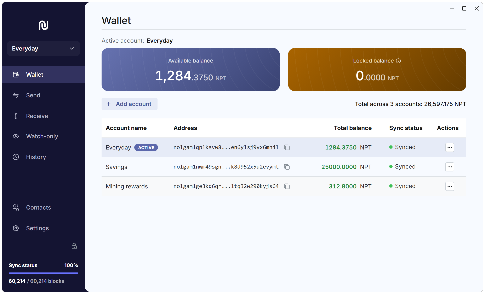

# Neptune Wallet

[](https://github.com/Neptune-Crypto/neptune-wallet-app/releases/latest)
[](https://github.com/Neptune-Crypto/neptune-wallet-app/actions/workflows/main.yml)

A desktop wallet for [Neptune Cash](https://neptune.cash) (NPT) on Windows, macOS and Linux.
Your seed phrase never leaves your computer. Each payment you send is also prepared on your
computer, including the zero-knowledge proof that shows the network the payment is valid
without revealing its details. To read the blockchain and pass your payments on to the network,
the wallet connects to a Neptune node, a server that keeps a copy of the blockchain. One is set
up for you, so you don't need to run your own.



## Download

Get the latest version from the [releases page](https://github.com/Neptune-Crypto/neptune-wallet-app/releases/latest).
Download Neptune Wallet only from that page. Fake wallets are a common way to steal coins, so
be careful with download links you find in messages, ads or search results.

| System                                        | File to download                         |
| --------------------------------------------- | ---------------------------------------- |
| Windows, 64-bit                               | `NeptuneWallet_<version>_x64-setup.exe`  |
| macOS 10.15 or later, Intel and Apple Silicon | `NeptuneWallet_<version>_universal.dmg`  |
| Linux x86-64, any distribution                | `NeptuneWallet_<version>_amd64.AppImage` |
| Debian, Ubuntu                                | `NeptuneWallet_<version>_amd64.deb`      |
| Fedora, openSUSE                              | `NeptuneWallet-<version>-1.x86_64.rpm`   |

The `.msi` is another Windows installer; most people want the `.exe`. You don't need the
`.sig` files, `latest.json` or the `.app.tar.gz`: the app's updater uses them.

### Check your download

The releases page shows a SHA-256 checksum next to each file. Compare it with the checksum of
the file you downloaded (letter case doesn't matter):

- Windows (PowerShell): `Get-FileHash <file>`
- macOS: `shasum -a 256 <file>`
- Linux: `sha256sum <file>`

If they differ, delete the file and download it again from the releases page.

### Updates

When the wallet starts, it checks the project's GitHub releases for a new version and offers to
install it. Updates are signed by the project, and the app won't install one whose signature
doesn't match. **Settings > About** shows your version, and links to the releases page when an
update is available.

## Getting started

1. Install the file you downloaded:
   - Windows: run the `setup.exe`.
   - macOS: open the `.dmg` and drag NeptuneWallet into Applications.
   - Linux: make the `.AppImage` executable (`chmod +x`) and run it, or install the `.deb` or
     `.rpm` with your package manager, for example
     `sudo apt install ./NeptuneWallet_<version>_amd64.deb`.
2. Open Neptune Wallet and choose **Create a new account**, or **Import an existing account** if
   you already have a seed phrase (see [Back up and restore](#back-up-and-restore)).
3. Choose a password. It unlocks the app on this computer only, and nobody can recover it for
   you.
4. If you created a new account, write down your 18-word seed phrase, then fill in the words the
   app asks for to confirm it. Read [Keep your seed phrase safe](#keep-your-seed-phrase-safe)
   first.
5. Let the wallet catch up with the blockchain. **Sync status** in the sidebar shows its
   progress, and your balance is up to date when it reaches 100%.
6. To receive NPT, open **Receive**, stay on the **Generation** tab, and copy an address or show
   its QR code. Send that address to whoever is paying you.

## Keep your seed phrase safe

- Write it down and keep it offline. It is the only way to restore your account if your
  computer is lost or broken, or if you forget your password.
- Anyone who has it can spend your funds. Never share it, and never type it into a website,
  a chat or a form.
- Nobody from the Neptune project will ever ask for your seed phrase. Anyone who does is
  trying to steal from you.

## Using the wallet

- **Wallet** lists your accounts and their balances. **Add account** creates or imports another
  account; each account has its own seed phrase.
- **Receive** lists your addresses. **Generation** addresses are the default and the most
  private. The app explains the other address types when you select them.
- **Send** pays one or more recipients in one transaction. Before the transaction goes out, the
  wallet builds its proof on your computer, which takes a while, and longer on a slower
  computer. Keep the app open until the transaction is listed under **Transactions awaiting
  network confirmation**. Payments can't be reversed, so check the address before you send.
- **Watch-only** shows what an address receives, using the viewing key its owner gives you, and
  can never spend. Add the address's receiver preimage as well to also see its spends and
  balance.
- **Contacts** keeps the addresses you pay often.
- **History** lists your payments (**Activity**) and the individual coins that make up your
  balance (**UTXOs**).

One password unlocks the app and all its accounts on this computer. The app locks itself after
15 minutes of inactivity by default (**Settings > Security > Auto-lock**).

## Back up and restore

- Your seed phrase restores your coins on any computer: choose **Import an existing account**
  and enter it. The wallet checks the 25 addresses after the last one that received coins, so
  if you ever created more than 25 addresses in a row that received nothing, set **Number of
  keys** higher, or later payments may not show. Leave **Start block height** at 0 unless you
  know a block height from before the account's first payment.
- The seed phrase doesn't bring back your contacts, watch-only addresses or settings. Those are
  only stored in the app's data folder:
  - Windows: `%APPDATA%\org.neptunefundamentals.wallet`
  - macOS: `~/Library/Application Support/org.neptunefundamentals.wallet`
  - Linux: `~/.config/org.neptunefundamentals.wallet` (or under `$XDG_CONFIG_HOME` if set)
- **Settings > Data & storage > Open data directory** shows the folder in your file manager.
  It holds your seed phrases too, so keep any copy of it private.
- On Windows and Linux, the app's window keeps a second, smaller folder with the same name in
  `%LOCALAPPDATA%` or `~/.local/share`.

## Privacy and security

By default the wallet connects to the node at `https://wallet.neptunefundamentals.org`. You can
switch to another node, such as your own
[neptune-core](https://github.com/Neptune-Crypto/neptune-core) node, in **Settings >
Connection > Remote node URL**. Use an `https://` address for any node that isn't on your own
computer or home network.

- The node never receives your seed phrase or private keys, so it cannot spend your funds,
  whoever runs it.
- The wallet downloads whole blocks from the node and works out your balances and payments from
  them itself, so syncing doesn't tell the node which coins are yours. If the node can't be
  reached, the wallet can't sync or send, but your coins are safe and you can switch to another
  node in Settings.
- When you send, the wallet asks the node for data about the coins you are spending and passes
  the payment to the network through it. The node learns only what the published payment would
  reveal, together with your IP address, even if you cancel the payment before it is sent.
- **Import randomness** reveals more: the node learns which coins on the blockchain the imported
  ones are, and can recognise them later when they are spent.
- Some older coins have to be made public before they can be spent; this is a network rule.
  The app asks first (**Reveal & send**). Those coins' amounts and the address that holds them
  become public, and your other coins are not affected.
- When the app starts, it asks GitHub whether there is a new version, so GitHub sees your IP
  address.
- Block explorer links in the app open `neptunefundamentals.org` in your browser, which then
  sees what you looked up.

## Getting help

Ask questions on the [Neptune forum](https://talk.neptune.cash), and report bugs in
[GitHub issues](https://github.com/Neptune-Crypto/neptune-wallet-app/issues). Include your app
version (**Settings > About**) and your operating system. If it helps, add the log from
**Settings > Logs**.

Never post your seed phrase or password, and check logs and screenshots for addresses you would
rather keep private. Ignore anyone who contacts you privately offering help.

## Build from source

### Prerequisites

- Rust, installed with [rustup](https://rustup.rs). You don't need to pick a toolchain:
  `rust-toolchain.toml` makes rustup use a nightly toolchain, which the code needs.
- Node.js 24 (the version CI uses) and Yarn 1 (`npm install -g yarn`).
- The system libraries Tauri needs. For Windows, macOS and other Linux distributions see
  [Tauri's prerequisites](https://v2.tauri.app/start/prerequisites/). On Debian or Ubuntu:

  ```bash
  sudo apt install build-essential file libgtk-3-dev libwebkit2gtk-4.1-dev libayatana-appindicator3-dev librsvg2-dev libssl-dev
  ```

### Run in development mode

The dev build uses the same data folder as an installed Neptune Wallet, so it opens your real
accounts. On Windows, add `-c core.autocrlf=false` to the `git clone` command, or `yarn lint`
flags every file.

```bash
git clone https://github.com/Neptune-Crypto/neptune-wallet-app.git
cd neptune-wallet-app
yarn install
yarn tauri dev
```

The first build compiles Triton VM and the other Rust dependencies from source, so it is much
slower than later builds. The frontend dev server needs port 3001 to be free.

### Build release packages

On Windows, set a larger stack first, as CI does, or Triton VM's build script overflows its
stack:

```powershell
$env:RUSTFLAGS = "-C link-args=/STACK:8388608"
```

Then build:

```bash
yarn tauri build --no-sign
```

`--no-sign` skips signing the update files. Signing needs the project's private key, so only CI
does it, for official releases. The installers end up in a `bundle` folder under
`src-tauri/target/`.

For a universal macOS build, add both targets and pass `--target`:

```bash
rustup target add aarch64-apple-darwin x86_64-apple-darwin
yarn tauri build --no-sign --target universal-apple-darwin
```
